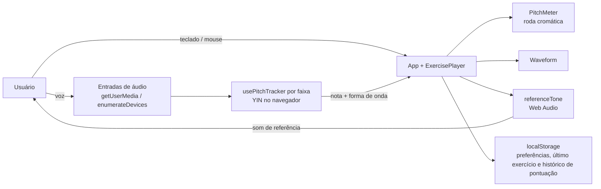
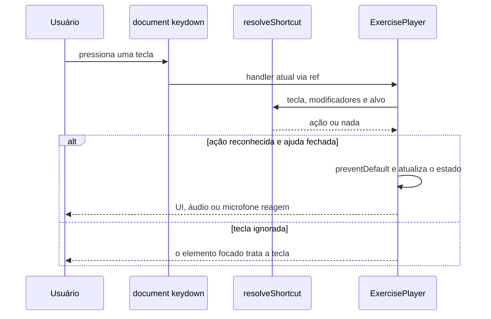

# singer-trainer

App pessoal de treinamento de canto com feedback visual de afinação em tempo real. Uma
roda cromática mostra as 12 notas em ordem de altura do som (como um relógio), com um
indicador que desliza suavemente conforme você canta e destaca a nota-alvo do exercício.

Não requer conhecimento prévio de teoria musical — a posição no círculo já comunica o
quão perto você está da nota certa.

## Funcionalidades

- **Feedback de afinação em tempo real** — detecção de pitch (algoritmo YIN) rodando
  100% no navegador, sem servidor.
- **Exercícios prontos** — escala maior, sirene, lip trill, respiração sustentada,
  arpejo maior, escala de 5 notas, saltos de oitava, escala menor e escala menor em
  degraus.
- **Play/pause e mudo** — pausar congela o tom de referência e o indicador de afinação
  exatamente onde estavam, sem reiniciar o exercício.
- **Controle de velocidade e repetição** do exercício, com preferências salvas
  localmente.
- **Sensibilidade do microfone ajustável** — calibra o quão exigente a detecção de pitch
  é ao aceitar um som como nota certa.
- **Bolhas clicáveis** — toque em qualquer nota da roda pra ouvir como ela soa.
- Página única com dropdown de exercícios — trocar de exercício não pede acesso ao
  microfone de novo, e a última lição escolhida fica salva entre recarregamentos.
- **Controles pelo teclado** — setas navegam entre as notas da roda (Enter toca a nota,
  Home volta ao C), Espaço toca/pausa o exercício, `-`/`+` mudam a velocidade, `,`/`.` a
  sensibilidade do microfone, S/M/R alternam som, microfone e repetição,
  PageUp/PageDown ou `[`/`]` trocam o exercício e `?` mostra a lista de atalhos.
- **Pontuação e histórico** — placar no canto superior direito com o tempo afinado (±10
  cents da nota-alvo, em qualquer oitava) e a % de acerto da sessão e geral; cada passada
  completa é gravada no navegador, e o painel de histórico (clique no placar ou H) mostra
  os recordes por exercício e as últimas passadas.
- **Várias entradas** — cada entrada de áudio vira uma faixa com a própria roda, onda e
  pontuação: adicione o seu microfone, o "Monitor of …" do sistema (para captar a voz de
  um vídeo tocando em outra aba) ou outro mic, com "+ Adicionar entrada". Cada faixa tem
  seletor de dispositivo e liga/desliga; a montagem fica salva, e uma entrada
  desconectada aparece como tal até voltar. A tecla M liga/desliga o microfone da
  primeira entrada (as outras usam o próprio botão). Ao adicionar, o app escolhe primeiro um
  "Monitor of …" livre.

  > **Fone Bluetooth:** evite usar o **microfone** de um fone Bluetooth como entrada. Abrir ou
  > fechar esse microfone troca o fone para o modo de chamada e, no Linux (PipeWire), pode
  > travar o som do fone para o navegador — o vídeo do YouTube para e não volta. Para destravar,
  > desconecte e reconecte o fone. Capturar o "Monitor of …" do fone não tem esse problema.
- **Atraso por entrada** — botão ⏱ em cada faixa: calibre automaticamente (o app toca notas
  de teste e mede o atraso, ideal para o "Monitor of …") ou ajuste à mão; o atraso é
  compensado no piano-roll e na pontuação.
- **Visualizações** — além da roda cromática (padrão, mais didática), escolha na barra do
  topo (ou com V) entre **piano-roll** (altura da voz ao longo do tempo sobre a nota-alvo),
  **afinador cromático** (nota grande e ponteiro de ±50 cents) e **teclado** de duas
  oitavas com a tecla cantada acesa. A escolha fica salva.
- **Entrada de áudio como referência** — no exercício "Entrada de áudio", escolha uma
  entrada (ex.: o "Monitor of …" com um vídeo do YouTube tocando) como referência: as notas
  dela viram o alvo das outras faixas, e a pontuação vale enquanto a referência canta
  (acerto se você cantar a mesma nota, em qualquer oitava, até 0,5 s depois).
- **Exercício livre** — cante junto com uma música tocando em outra aba (de fone): cada
  entrada é medida contra a nota mais próxima, o tempo só conta enquanto há voz, e a roda
  mostra a % de acerto de cada nota; o histórico guarda o acerto por nota de cada entrada.

## Rodando localmente

```bash
cd frontend
npm install
npm run dev
```

Testes:

```bash
npm test
```

## Docker

Build local (dev/teste, sem publicar):

```bash
docker build -t singer-trainer:dev frontend
```

**Release**: as imagens são versionadas em SemVer (`x.y.z`) mais `latest`, publicadas no
GHCR pelo workflow **Release and build** do GitHub Actions
([`.github/workflows/release-and-build.yml`](.github/workflows/release-and-build.yml)) —
Actions → *Release and build* → Run workflow → `patch` / `minor` / `major`. Cada execução
cria a tag, o release no GitHub e publica:

```
ghcr.io/marcelofmatos/singer-trainer:<x.y.z>
ghcr.io/marcelofmatos/singer-trainer:<x.y>
ghcr.io/marcelofmatos/singer-trainer:<x>
ghcr.io/marcelofmatos/singer-trainer:latest
```

Versões já publicadas nunca são sobrescritas — uma correção ou feature nova é sempre uma
versão nova (SemVer).

A stack de deploy (compose, variáveis de ambiente, proxy) fica fora deste repositório,
num diretório de infraestrutura separado.

## Arquitetura e decisões de design

### Arquitetura



### Fluxo de um atalho de teclado



O histórico completo de especificações e planos de implementação está em
[`docs/superpowers/specs/`](docs/superpowers/specs/) e
[`docs/superpowers/plans/`](docs/superpowers/plans/).

## Fora de escopo (por enquanto)

Gravação de tentativas, histórico de evolução entre sessões e organização de repertório
não fazem parte desta primeira fatia do app.
