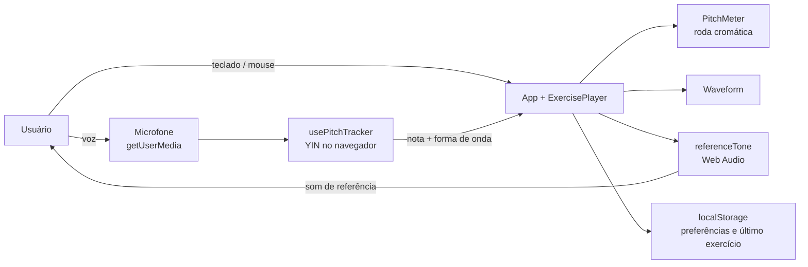
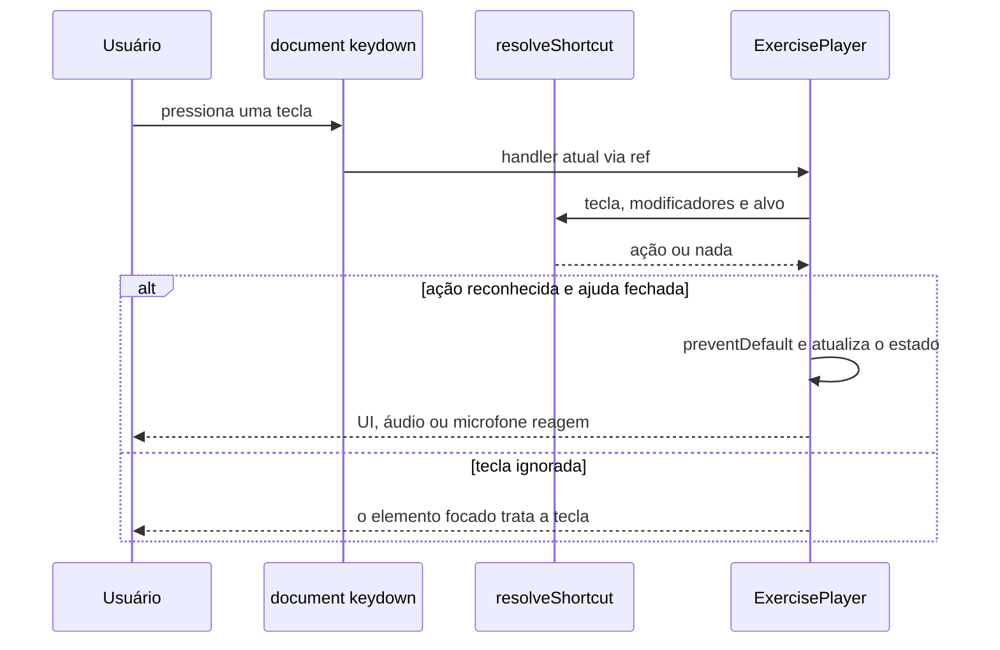

# Controles e navegação pelo teclado — Implementation Plan

> **For agentic workers:** REQUIRED SUB-SKILL: Use superpowers:subagent-driven-development (recommended) or superpowers:executing-plans to implement this plan task-by-task. Steps use checkbox (`- [ ]`) syntax for tracking.

**Goal:** Atalhos globais de teclado (reprodução, som, microfone, loop, velocidade, sensibilidade, troca de exercício, ajuda), ligar/desligar o microfone, roda cromática com roving tabindex e painel de ajuda.

**Architecture:** Um mapa de teclas puro (`resolveShortcut`) decide a ação a partir do evento; um único listener de `keydown` no `document` (dentro do `ExercisePlayer`) executa a ação. O `usePitchTracker` ganha um parâmetro `enabled` que abre/libera o stream do microfone. Um `<dialog>` nativo lista os atalhos a partir da mesma tabela exportada pelo mapa.

**Tech Stack:** React 18 + TypeScript, Vite, Vitest + Testing Library (jsdom 25).

**Spec:** `docs/superpowers/specs/2026-10-22-keyboard-controls-design.md`

**Convenções do repo:**
- Rodar comandos de dentro de `frontend/` (`npm test`, `npx tsc -b`).
- Commits com a identidade já configurada no git (`Marcelo Matos <contato@marcelomatos.dev>`), **sem** trailer `Co-Authored-By`.
- Textos de UI em português; código e comentários em inglês.

---

## File Structure

| Arquivo | Responsabilidade |
| --- | --- |
| `frontend/src/lib/keyboardShortcuts.ts` (novo) | Mapa tecla→ação, regras de foco/modificadores, tabela de ajuda, `stepWithin` |
| `frontend/src/lib/keyboardShortcuts.test.ts` (novo) | Testes do mapa |
| `frontend/src/hooks/usePitchTracker.ts` | Parâmetro `enabled` e status `'off'` |
| `frontend/src/hooks/usePitchTracker.test.ts` (novo) | Testes de ligar/desligar o mic |
| `frontend/src/components/PitchMeter.tsx` | Roving tabindex e setas na roda |
| `frontend/src/components/KeyboardHelp.tsx` (novo) | Diálogo com a tabela de atalhos |
| `frontend/src/test/setup.ts` (novo) | Stub de `HTMLDialogElement.showModal/close` para o jsdom |
| `frontend/vite.config.ts` | Registra o `setupFiles` |
| `frontend/src/components/ExercisePlayer.tsx` | Listener de teclado, botão 🎙️, botão ⌨️, status "Microfone desligado" |
| `frontend/src/App.tsx` | Callbacks de exercício anterior/próximo (com volta) |
| `frontend/src/index.css` | Estilo do diálogo e do botão de mic desligado |
| `README.md` | Funcionalidade nova + diagramas de Arquitetura e Fluxo (Mermaid) |

---

### Task 1: Mapa de atalhos puro

**Files:**
- Create: `frontend/src/lib/keyboardShortcuts.ts`
- Test: `frontend/src/lib/keyboardShortcuts.test.ts`

- [ ] **Step 1: Write the failing tests**

```ts
// frontend/src/lib/keyboardShortcuts.test.ts
import { describe, expect, it } from 'vitest';
import { resolveShortcut, SHORTCUT_HELP, stepWithin, type ShortcutKeyEvent } from './keyboardShortcuts';

function keyEvent(key: string, overrides: Partial<ShortcutKeyEvent> = {}): ShortcutKeyEvent {
  return { key, ctrlKey: false, altKey: false, metaKey: false, target: document.body, ...overrides };
}

function input(type: string): HTMLInputElement {
  const element = document.createElement('input');
  element.type = type;
  return element;
}

describe('resolveShortcut', () => {
  it.each([
    [' ', 'togglePlay'],
    ['s', 'toggleMute'],
    ['m', 'toggleMic'],
    ['r', 'toggleLoop'],
    ['ArrowLeft', 'slower'],
    ['ArrowRight', 'faster'],
    ['ArrowDown', 'lessSensitive'],
    ['ArrowUp', 'moreSensitive'],
    ['PageUp', 'previousExercise'],
    ['[', 'previousExercise'],
    ['PageDown', 'nextExercise'],
    [']', 'nextExercise'],
    ['?', 'showHelp'],
  ])('maps %j to %s', (key, action) => {
    expect(resolveShortcut(keyEvent(key))).toBe(action);
  });

  it('accepts uppercase letters (Caps Lock or Shift)', () => {
    expect(resolveShortcut(keyEvent('S'))).toBe('toggleMute');
    expect(resolveShortcut(keyEvent('M'))).toBe('toggleMic');
  });

  it('returns null for unmapped keys', () => {
    expect(resolveShortcut(keyEvent('x'))).toBeNull();
    expect(resolveShortcut(keyEvent('Enter'))).toBeNull();
  });

  it.each(['ctrlKey', 'altKey', 'metaKey'] as const)('ignores shortcuts while %s is held', (modifier) => {
    expect(resolveShortcut(keyEvent('s', { [modifier]: true }))).toBeNull();
  });

  it('ignores every key while a select, textarea or text input is focused', () => {
    for (const target of [document.createElement('select'), document.createElement('textarea'), input('text')]) {
      expect(resolveShortcut(keyEvent('s', { target }))).toBeNull();
      expect(resolveShortcut(keyEvent(' ', { target }))).toBeNull();
    }
  });

  it('lets a focused button keep Space and arrows but still honors letter shortcuts', () => {
    const button = document.createElement('button');
    expect(resolveShortcut(keyEvent(' ', { target: button }))).toBeNull();
    expect(resolveShortcut(keyEvent('ArrowRight', { target: button }))).toBeNull();
    expect(resolveShortcut(keyEvent('s', { target: button }))).toBe('toggleMute');
  });

  it('treats role="button" elements and checkboxes like buttons', () => {
    const bubble = document.createElement('div');
    bubble.setAttribute('role', 'button');
    expect(resolveShortcut(keyEvent('ArrowLeft', { target: bubble }))).toBeNull();
    expect(resolveShortcut(keyEvent('m', { target: bubble }))).toBe('toggleMic');
    expect(resolveShortcut(keyEvent(' ', { target: input('checkbox') }))).toBeNull();
    expect(resolveShortcut(keyEvent('r', { target: input('checkbox') }))).toBe('toggleLoop');
  });

  it('lets a focused range slider keep arrows and PageUp/PageDown', () => {
    const slider = input('range');
    expect(resolveShortcut(keyEvent('ArrowUp', { target: slider }))).toBeNull();
    expect(resolveShortcut(keyEvent('PageDown', { target: slider }))).toBeNull();
    expect(resolveShortcut(keyEvent(']', { target: slider }))).toBe('nextExercise');
    expect(resolveShortcut(keyEvent(' ', { target: slider }))).toBe('togglePlay');
  });
});

describe('stepWithin', () => {
  it('steps and clamps to the range', () => {
    expect(stepWithin(1, 0.25, 0.5, 2)).toBe(1.25);
    expect(stepWithin(2, 0.25, 0.5, 2)).toBe(2);
    expect(stepWithin(0.5, -0.25, 0.5, 2)).toBe(0.5);
  });

  it('rounds away floating point drift', () => {
    expect(stepWithin(0.15, 0.05, 0.05, 0.35)).toBe(0.2);
    expect(stepWithin(0.1, 0.05, 0.05, 0.35)).toBe(0.15);
  });
});

describe('SHORTCUT_HELP', () => {
  it('lists every shortcut with a description', () => {
    expect(SHORTCUT_HELP.length).toBeGreaterThanOrEqual(9);
    SHORTCUT_HELP.forEach(({ keys, description }) => {
      expect(keys).not.toBe('');
      expect(description).not.toBe('');
    });
  });
});
```

- [ ] **Step 2: Run tests to verify they fail**

Run: `cd frontend && npx vitest run src/lib/keyboardShortcuts.test.ts`
Expected: FAIL — `Failed to resolve import "./keyboardShortcuts"`.

- [ ] **Step 3: Implement**

```ts
// frontend/src/lib/keyboardShortcuts.ts
export type ShortcutAction =
  | 'togglePlay'
  | 'toggleMute'
  | 'toggleMic'
  | 'toggleLoop'
  | 'slower'
  | 'faster'
  | 'lessSensitive'
  | 'moreSensitive'
  | 'previousExercise'
  | 'nextExercise'
  | 'showHelp';

/** The subset of a KeyboardEvent that resolveShortcut needs (keeps it testable without real events). */
export interface ShortcutKeyEvent {
  key: string;
  ctrlKey: boolean;
  altKey: boolean;
  metaKey: boolean;
  target: EventTarget | null;
}

const ACTIONS_BY_KEY: Record<string, ShortcutAction> = {
  ' ': 'togglePlay',
  s: 'toggleMute',
  m: 'toggleMic',
  r: 'toggleLoop',
  ArrowLeft: 'slower',
  ArrowRight: 'faster',
  ArrowDown: 'lessSensitive',
  ArrowUp: 'moreSensitive',
  PageUp: 'previousExercise',
  '[': 'previousExercise',
  PageDown: 'nextExercise',
  ']': 'nextExercise',
  '?': 'showHelp',
};

const ARROW_KEYS = ['ArrowLeft', 'ArrowRight', 'ArrowUp', 'ArrowDown'];

/**
 * Keys the focused element already handles natively (or, for the wheel bubbles, by its own
 * handler). Only those keys are left alone — other shortcuts keep working, so a button that
 * kept focus after a mouse click doesn't swallow every shortcut.
 */
function keysOwnedByFocus(target: EventTarget | null): 'all' | string[] {
  if (!(target instanceof Element)) return [];
  if (target.matches('select, textarea')) return 'all';
  if (target instanceof HTMLInputElement) {
    if (target.type === 'range') return [...ARROW_KEYS, 'PageUp', 'PageDown'];
    if (target.type === 'checkbox') return [' ', ...ARROW_KEYS];
    return 'all';
  }
  if (target.matches('button, [role="button"]')) return [' ', ...ARROW_KEYS];
  return [];
}

export function resolveShortcut(event: ShortcutKeyEvent): ShortcutAction | null {
  if (event.ctrlKey || event.altKey || event.metaKey) return null;
  const key = event.key.length === 1 ? event.key.toLowerCase() : event.key;
  const action = ACTIONS_BY_KEY[key];
  if (!action) return null;
  const owned = keysOwnedByFocus(event.target);
  if (owned === 'all' || owned.includes(key)) return null;
  return action;
}

/** Rows of the keyboard help dialog — kept next to the key map so the two never diverge. */
export const SHORTCUT_HELP: { keys: string; description: string }[] = [
  { keys: 'Espaço', description: 'Tocar / pausar / reiniciar' },
  { keys: 'S', description: 'Silenciar / ativar o som da referência' },
  { keys: 'M', description: 'Ligar / desligar o microfone' },
  { keys: 'R', description: 'Repetir o exercício' },
  { keys: '← / →', description: 'Diminuir / aumentar a velocidade' },
  { keys: '↓ / ↑', description: 'Diminuir / aumentar a sensibilidade do microfone' },
  { keys: 'PageUp ou [', description: 'Exercício anterior' },
  { keys: 'PageDown ou ]', description: 'Próximo exercício' },
  { keys: '?', description: 'Mostrar estes atalhos' },
  { keys: 'Setas na roda', description: 'Navegar entre as notas (Enter toca a nota)' },
];

/** Adds `delta` to `value`, clamped to [min, max] and rounded to 2 decimals (slider steps are 0.05/0.25). */
export function stepWithin(value: number, delta: number, min: number, max: number): number {
  return Math.min(max, Math.max(min, Math.round((value + delta) * 100) / 100));
}
```

- [ ] **Step 4: Run tests to verify they pass**

Run: `cd frontend && npx vitest run src/lib/keyboardShortcuts.test.ts`
Expected: PASS (all tests).

- [ ] **Step 5: Commit**

```bash
git add frontend/src/lib/keyboardShortcuts.ts frontend/src/lib/keyboardShortcuts.test.ts
git commit -m "feat: add pure keyboard shortcut resolver"
```

---

### Task 2: Microfone liga/desliga no `usePitchTracker`

**Files:**
- Modify: `frontend/src/hooks/usePitchTracker.ts`
- Test: `frontend/src/hooks/usePitchTracker.test.ts` (novo)

- [ ] **Step 1: Write the failing tests**

```ts
// frontend/src/hooks/usePitchTracker.test.ts
import { afterEach, beforeEach, describe, expect, it, vi } from 'vitest';
import { renderHook, waitFor } from '@testing-library/react';
import { usePitchTracker } from './usePitchTracker';

let stopSpies: ReturnType<typeof vi.fn>[] = [];
let getUserMedia: ReturnType<typeof vi.fn>;

class MockAudioContext {
  sampleRate = 44100;
  createMediaStreamSource() {
    return { connect() {} };
  }
  createAnalyser() {
    return { fftSize: 0, getFloatTimeDomainData() {} };
  }
  close() {
    return Promise.resolve();
  }
}

describe('usePitchTracker', () => {
  beforeEach(() => {
    stopSpies = [];
    getUserMedia = vi.fn(async () => {
      const stop = vi.fn();
      stopSpies.push(stop);
      return { getTracks: () => [{ stop }] };
    });
    vi.stubGlobal('AudioContext', MockAudioContext);
    Object.defineProperty(navigator, 'mediaDevices', {
      value: { getUserMedia },
      configurable: true,
    });
  });

  afterEach(() => {
    vi.unstubAllGlobals();
  });

  it('opens the microphone and listens when enabled', async () => {
    const { result } = renderHook(() => usePitchTracker(0.15, true));
    await waitFor(() => expect(result.current.status).toBe('listening'));
    expect(getUserMedia).toHaveBeenCalledTimes(1);
  });

  it('does not open the microphone and reports "off" when disabled', () => {
    const { result } = renderHook(() => usePitchTracker(0.15, false));
    expect(result.current.status).toBe('off');
    expect(result.current.currentNote).toBeNull();
    expect(result.current.waveform).toEqual([]);
    expect(getUserMedia).not.toHaveBeenCalled();
  });

  it('releases the stream when disabled and reopens it when re-enabled', async () => {
    const { result, rerender } = renderHook(({ enabled }) => usePitchTracker(0.15, enabled), {
      initialProps: { enabled: true },
    });
    await waitFor(() => expect(result.current.status).toBe('listening'));

    rerender({ enabled: false });
    expect(result.current.status).toBe('off');
    expect(stopSpies[0]).toHaveBeenCalled();

    rerender({ enabled: true });
    await waitFor(() => expect(result.current.status).toBe('listening'));
    expect(getUserMedia).toHaveBeenCalledTimes(2);
  });
});
```

- [ ] **Step 2: Run tests to verify they fail**

Run: `cd frontend && npx vitest run src/hooks/usePitchTracker.test.ts`
Expected: FAIL — the "disabled" tests fail (status is `'requesting'`/`'listening'`, `getUserMedia` is called, and `'off'` is not a valid status).

- [ ] **Step 3: Implement**

In `frontend/src/hooks/usePitchTracker.ts`:

1. Status type:

```ts
export type PitchTrackerStatus = 'requesting' | 'listening' | 'error' | 'off';
```

2. Update the doc comment and signature, and make the effect depend on `enabled`:

```ts
/**
 * Listens to the microphone and reports the detected note and a rolling waveform buffer
 * ~20 times/sec while `enabled`. Turning `enabled` off releases the stream (the browser's
 * recording indicator goes away) and reports status 'off'; turning it back on reopens it.
 *
 * `sensitivity` is the YIN detection threshold: lower = stricter (fewer false positives
 * on noise/breath, but may miss soft/unclear pitches), higher = more lenient. It's read
 * via a ref inside the polling loop so adjusting it never re-requests microphone access
 * or tears down the existing audio graph.
 */
export function usePitchTracker(
  sensitivity: number = DEFAULT_THRESHOLD,
  enabled: boolean = true
): PitchTrackerState {
  const [state, setState] = useState<PitchTrackerState>({
    status: enabled ? 'requesting' : 'off',
    errorMessage: null,
    currentNote: null,
    waveform: [],
  });
```

3. At the top of the mic effect body (before `let cancelled = false;`):

```ts
  useEffect(() => {
    if (!enabled) {
      setState({ status: 'off', errorMessage: null, currentNote: null, waveform: [] });
      return;
    }
    setState({ status: 'requesting', errorMessage: null, currentNote: null, waveform: [] });

    let cancelled = false;
```

4. Change that effect's dependency array from `[]` to `[enabled]`. The rest of the effect (start, interval, cleanup) stays as is — the existing cleanup already stops the tracks, clears the interval and closes the `AudioContext` when `enabled` flips to `false`.

- [ ] **Step 4: Run tests to verify they pass**

Run: `cd frontend && npx vitest run src/hooks/usePitchTracker.test.ts && npx tsc -b`
Expected: PASS, and `tsc` with no errors.

- [ ] **Step 5: Commit**

```bash
git add frontend/src/hooks/usePitchTracker.ts frontend/src/hooks/usePitchTracker.test.ts
git commit -m "feat: let the pitch tracker release and reopen the microphone"
```

---

### Task 3: Roda cromática com roving tabindex

**Files:**
- Modify: `frontend/src/components/PitchMeter.tsx`
- Test: `frontend/src/components/PitchMeter.test.tsx`

- [ ] **Step 1: Write the failing tests** (append inside the existing `describe('PitchMeter', ...)`)

```tsx
  it('exposes a single tab stop on the wheel, starting at C', () => {
    render(
      <PitchMeter detectedNote={null} targetMidiNumber={null} micDisconnected={false} onNoteClick={() => {}} />
    );
    const names = ['C', 'C#', 'D', 'D#', 'E', 'F', 'F#', 'G', 'G#', 'A', 'A#', 'B'];
    const tabIndexes = names.map((name) => screen.getByTestId(`note-bubble-${name}`).getAttribute('tabindex'));
    expect(tabIndexes.filter((value) => value === '0')).toHaveLength(1);
    expect(screen.getByTestId('note-bubble-C').getAttribute('tabindex')).toBe('0');
  });

  it('moves focus around the wheel with the arrow keys, wrapping B<->C', () => {
    render(
      <PitchMeter detectedNote={null} targetMidiNumber={null} micDisconnected={false} onNoteClick={() => {}} />
    );
    const c = screen.getByTestId('note-bubble-C');
    c.focus();

    fireEvent.keyDown(c, { key: 'ArrowRight' });
    expect(document.activeElement).toBe(screen.getByTestId('note-bubble-C#'));

    fireEvent.keyDown(document.activeElement!, { key: 'ArrowUp' });
    fireEvent.keyDown(document.activeElement!, { key: 'ArrowLeft' });
    expect(document.activeElement).toBe(screen.getByTestId('note-bubble-B'));

    fireEvent.keyDown(document.activeElement!, { key: 'ArrowDown' });
    expect(document.activeElement).toBe(c);
    expect(screen.getByTestId('note-bubble-B').getAttribute('tabindex')).toBe('-1');
  });

  it('jumps back to C with Home', () => {
    render(
      <PitchMeter detectedNote={null} targetMidiNumber={null} micDisconnected={false} onNoteClick={() => {}} />
    );
    const g = screen.getByTestId('note-bubble-G');
    g.focus();
    fireEvent.keyDown(g, { key: 'Home' });
    expect(document.activeElement).toBe(screen.getByTestId('note-bubble-C'));
  });
```

- [ ] **Step 2: Run tests to verify they fail**

Run: `cd frontend && npx vitest run src/components/PitchMeter.test.tsx`
Expected: FAIL — every bubble has `tabindex="0"`, arrows don't move focus.

- [ ] **Step 3: Implement**

In `frontend/src/components/PitchMeter.tsx`, add a constant and state/refs inside the component (after the trail state):

```ts
const NOTE_COUNT = CHROMATIC_NOTE_NAMES.length;
```

(put it with the other module-level constants), and inside `PitchMeter`:

```ts
  // Roving tabindex: the wheel is one tab stop; arrows move focus between bubbles.
  const [focusableIndex, setFocusableIndex] = useState(0);
  const bubbleRefs = useRef<(SVGGElement | null)[]>([]);

  function moveFocus(index: number) {
    setFocusableIndex(index);
    bubbleRefs.current[index]?.focus();
  }

  function handleBubbleKeyDown(event: React.KeyboardEvent, index: number) {
    if (!onNoteClick) return;
    switch (event.key) {
      case 'Enter':
      case ' ':
        onNoteClick(index);
        break;
      case 'ArrowRight':
      case 'ArrowDown':
        moveFocus((index + 1) % NOTE_COUNT);
        break;
      case 'ArrowLeft':
      case 'ArrowUp':
        moveFocus((index + NOTE_COUNT - 1) % NOTE_COUNT);
        break;
      case 'Home':
        moveFocus(0);
        break;
      default:
        return;
    }
    event.preventDefault();
  }
```

Add `import type { KeyboardEvent } from 'react';` is not needed if you write `React.KeyboardEvent` — prefer importing the type to match the file's named-import style:

```ts
import { useEffect, useRef, useState, type KeyboardEvent } from 'react';
```

and use `event: KeyboardEvent` in `handleBubbleKeyDown`.

Replace the bubble `<g>` attributes (`tabIndex` and `onKeyDown`) with:

```tsx
          <g
            key={name}
            ref={(element) => {
              bubbleRefs.current[index] = element;
            }}
            data-testid={`note-bubble-${name}`}
            data-active={isTarget ? 'true' : 'false'}
            role={onNoteClick ? 'button' : undefined}
            tabIndex={onNoteClick ? (index === focusableIndex ? 0 : -1) : undefined}
            style={onNoteClick ? { cursor: 'pointer' } : undefined}
            onClick={onNoteClick ? () => onNoteClick(index) : undefined}
            onFocus={onNoteClick ? () => setFocusableIndex(index) : undefined}
            onKeyDown={onNoteClick ? (event) => handleBubbleKeyDown(event, index) : undefined}
          >
```

- [ ] **Step 4: Run tests to verify they pass**

Run: `cd frontend && npx vitest run src/components/PitchMeter.test.tsx && npx tsc -b`
Expected: PASS (new and existing tests, including the Enter-activates test), `tsc` clean.

- [ ] **Step 5: Commit**

```bash
git add frontend/src/components/PitchMeter.tsx frontend/src/components/PitchMeter.test.tsx
git commit -m "feat: make the chromatic wheel a single tab stop with arrow-key navigation"
```

---

### Task 4: Painel de ajuda (`KeyboardHelp`)

**Files:**
- Create: `frontend/src/test/setup.ts`
- Modify: `frontend/vite.config.ts`
- Create: `frontend/src/components/KeyboardHelp.tsx`
- Test: `frontend/src/components/KeyboardHelp.test.tsx`

- [ ] **Step 1: Add the jsdom dialog stub and register it**

```ts
// frontend/src/test/setup.ts
// jsdom 25 doesn't implement HTMLDialogElement.showModal/close — emulate just the `open`
// attribute and the `close` event, which is all the components rely on.
HTMLDialogElement.prototype.showModal = function showModal(this: HTMLDialogElement) {
  this.setAttribute('open', '');
};
HTMLDialogElement.prototype.close = function close(this: HTMLDialogElement) {
  this.removeAttribute('open');
  this.dispatchEvent(new Event('close'));
};
```

In `frontend/vite.config.ts`, inside `test`:

```ts
  test: {
    environment: 'jsdom',
    globals: true,
    setupFiles: ['./src/test/setup.ts'],
  },
```

- [ ] **Step 2: Write the failing tests**

```tsx
// frontend/src/components/KeyboardHelp.test.tsx
import { describe, expect, it, vi } from 'vitest';
import { fireEvent, render, screen } from '@testing-library/react';
import { KeyboardHelp } from './KeyboardHelp';
import { SHORTCUT_HELP } from '../lib/keyboardShortcuts';

describe('KeyboardHelp', () => {
  it('is not shown while closed', () => {
    render(<KeyboardHelp open={false} onClose={() => {}} />);
    expect(screen.queryByRole('dialog')).toBeNull();
  });

  it('lists every shortcut when open', () => {
    render(<KeyboardHelp open onClose={() => {}} />);
    const dialog = screen.getByRole('dialog', { name: 'Atalhos de teclado' });
    SHORTCUT_HELP.forEach(({ keys, description }) => {
      expect(dialog.textContent).toContain(keys);
      expect(dialog.textContent).toContain(description);
    });
  });

  it('calls onClose from the close button', () => {
    const onClose = vi.fn();
    render(<KeyboardHelp open onClose={onClose} />);
    fireEvent.click(screen.getByRole('button', { name: 'Fechar' }));
    expect(onClose).toHaveBeenCalled();
  });

  it('calls onClose when the dialog closes on its own (Esc)', () => {
    const onClose = vi.fn();
    render(<KeyboardHelp open onClose={onClose} />);
    (screen.getByRole('dialog') as HTMLDialogElement).close();
    expect(onClose).toHaveBeenCalled();
  });
});
```

- [ ] **Step 3: Run tests to verify they fail**

Run: `cd frontend && npx vitest run src/components/KeyboardHelp.test.tsx`
Expected: FAIL — `Failed to resolve import "./KeyboardHelp"`.

- [ ] **Step 4: Implement**

```tsx
// frontend/src/components/KeyboardHelp.tsx
import { useEffect, useRef } from 'react';
import { SHORTCUT_HELP } from '../lib/keyboardShortcuts';

export interface KeyboardHelpProps {
  open: boolean;
  onClose: () => void;
}

/** Native modal <dialog> (focus trap and Esc come for free) listing the keyboard shortcuts. */
export function KeyboardHelp({ open, onClose }: KeyboardHelpProps) {
  const dialogRef = useRef<HTMLDialogElement>(null);

  useEffect(() => {
    const dialog = dialogRef.current;
    if (!dialog) return;
    if (open && !dialog.open) dialog.showModal();
    if (!open && dialog.open) dialog.close();
  }, [open]);

  return (
    <dialog
      ref={dialogRef}
      className="keyboard-help"
      aria-labelledby="keyboard-help-title"
      onClose={onClose}
    >
      <h2 id="keyboard-help-title" className="keyboard-help-title">
        Atalhos de teclado
      </h2>
      <table className="keyboard-help-table">
        <tbody>
          {SHORTCUT_HELP.map(({ keys, description }) => (
            <tr key={keys}>
              <th scope="row">
                <kbd>{keys}</kbd>
              </th>
              <td>{description}</td>
            </tr>
          ))}
        </tbody>
      </table>
      <button type="button" className="keyboard-help-close" onClick={onClose}>
        Fechar
      </button>
    </dialog>
  );
}
```

- [ ] **Step 5: Run tests to verify they pass**

Run: `cd frontend && npm test && npx tsc -b`
Expected: all test files PASS (the setup file must not break existing suites), `tsc` clean. If `tsc` complains that `src/test/setup.ts` is outside the project, check `frontend/tsconfig.json` `include` — it should already cover `src`.

- [ ] **Step 6: Commit**

```bash
git add frontend/src/test/setup.ts frontend/vite.config.ts frontend/src/components/KeyboardHelp.tsx frontend/src/components/KeyboardHelp.test.tsx
git commit -m "feat: add keyboard shortcuts help dialog"
```

---

### Task 5: Atalhos, microfone e ajuda no `ExercisePlayer`

**Files:**
- Modify: `frontend/src/components/ExercisePlayer.tsx`
- Test: `frontend/src/components/ExercisePlayer.test.tsx`

Context: in this test file `navigator.mediaDevices` is undefined, so the pitch tracker starts in status `'error'`; turning the mic off must still switch it to `'off'`. Default preferences (empty `localStorage`): speed `1.00x`, sensitivity `0.15`, loop off.

- [ ] **Step 1: Write the failing tests**

In `frontend/src/components/ExercisePlayer.test.tsx`:

1. Add `localStorage.clear();` as the first line of the existing `beforeEach`.
2. Add a helper after `advance`:

```tsx
function renderPlayer(overrides: { onPreviousExercise?: () => void; onNextExercise?: () => void } = {}) {
  return render(
    <ExercisePlayer
      exercise={TEST_EXERCISE}
      onPreviousExercise={overrides.onPreviousExercise ?? (() => {})}
      onNextExercise={overrides.onNextExercise ?? (() => {})}
    />
  );
}

function press(key: string, target: Element = document.body, init: KeyboardEventInit = {}) {
  fireEvent.keyDown(target, { key, ...init });
}
```

3. Replace the two existing `render(<ExercisePlayer exercise={TEST_EXERCISE} />);` calls with `renderPlayer();`.
4. Append a new `describe` block at the end of the file:

```tsx
describe('ExercisePlayer keyboard shortcuts', () => {
  beforeEach(() => {
    localStorage.clear();
    mockClockMs = 0;
    vi.stubGlobal('AudioContext', MockAudioContext);
    vi.useFakeTimers();
  });

  afterEach(() => {
    vi.useRealTimers();
    vi.unstubAllGlobals();
  });

  it('toggles playback with Space', () => {
    renderPlayer();
    press(' ');
    expect(screen.getByRole('button', { name: 'Retomar' })).toBeDefined();
    press(' ');
    expect(screen.getByRole('button', { name: 'Pausar' })).toBeDefined();
  });

  it('toggles the reference sound with S', () => {
    renderPlayer();
    press('s');
    expect(screen.getByRole('button', { name: 'Ativar som' })).toBeDefined();
  });

  it('toggles loop with R', () => {
    renderPlayer();
    const loop = screen.getByRole('checkbox', { name: 'Repetir' }) as HTMLInputElement;
    expect(loop.checked).toBe(false);
    press('r');
    expect(loop.checked).toBe(true);
  });

  it('steps the speed with the horizontal arrows and stops at the limit', () => {
    renderPlayer();
    press('ArrowRight');
    expect(screen.getByText('1.25x')).toBeDefined();
    for (let i = 0; i < 10; i++) press('ArrowRight');
    expect(screen.getByText('2.00x')).toBeDefined();
    press('ArrowLeft');
    expect(screen.getByText('1.75x')).toBeDefined();
  });

  it('steps the mic sensitivity with the vertical arrows and stops at the limit', () => {
    renderPlayer();
    press('ArrowUp');
    expect(screen.getByText('0.20')).toBeDefined();
    for (let i = 0; i < 10; i++) press('ArrowDown');
    expect(screen.getByText('0.05')).toBeDefined();
  });

  it('leaves arrows to a focused slider', () => {
    renderPlayer();
    press('ArrowRight', screen.getByRole('slider', { name: /velocidade/i }));
    expect(screen.getByText('1.00x')).toBeDefined();
  });

  it('still honors letter shortcuts while a button has focus', () => {
    renderPlayer();
    press('s', screen.getByRole('button', { name: 'Pausar' }));
    expect(screen.getByRole('button', { name: 'Ativar som' })).toBeDefined();
  });

  it('ignores shortcuts with Ctrl held', () => {
    renderPlayer();
    press('s', document.body, { ctrlKey: true });
    expect(screen.getByRole('button', { name: 'Silenciar' })).toBeDefined();
  });

  it('turns the microphone off and on with M and with the mic button', () => {
    renderPlayer();
    press('m');
    expect(screen.getByRole('button', { name: 'Ligar microfone' })).toBeDefined();
    expect(screen.getByText('Microfone desligado')).toBeDefined();

    fireEvent.click(screen.getByRole('button', { name: 'Ligar microfone' }));
    expect(screen.getByRole('button', { name: 'Desligar microfone' })).toBeDefined();
    expect(screen.queryByText('Microfone desligado')).toBeNull();
  });

  it('asks for the previous/next exercise with PageUp/PageDown and [ ]', () => {
    const onPreviousExercise = vi.fn();
    const onNextExercise = vi.fn();
    renderPlayer({ onPreviousExercise, onNextExercise });
    press('PageDown');
    press(']');
    press('PageUp');
    press('[');
    expect(onNextExercise).toHaveBeenCalledTimes(2);
    expect(onPreviousExercise).toHaveBeenCalledTimes(2);
  });

  it('opens the help with ? and suspends shortcuts while it is open', () => {
    renderPlayer();
    press('?', document.body, { shiftKey: true });
    expect(screen.getByRole('dialog', { name: 'Atalhos de teclado' })).toBeDefined();

    press('s');
    expect(screen.getByRole('button', { name: 'Silenciar' })).toBeDefined();

    fireEvent.click(screen.getByRole('button', { name: 'Fechar' }));
    expect(screen.queryByRole('dialog')).toBeNull();
  });

  it('opens the help from the keyboard button', () => {
    renderPlayer();
    fireEvent.click(screen.getByRole('button', { name: 'Atalhos de teclado' }));
    expect(screen.getByRole('dialog', { name: 'Atalhos de teclado' })).toBeDefined();
  });
});
```

- [ ] **Step 2: Run tests to verify they fail**

Run: `cd frontend && npx vitest run src/components/ExercisePlayer.test.tsx`
Expected: FAIL — shortcut tests fail (no listener, no mic/help buttons); `tsc`-level prop errors are fine at this point.

- [ ] **Step 3: Implement**

In `frontend/src/components/ExercisePlayer.tsx`:

1. Imports (add):

```ts
import { resolveShortcut, stepWithin } from '../lib/keyboardShortcuts';
import { KeyboardHelp } from './KeyboardHelp';
```

2. Props:

```ts
export interface ExercisePlayerProps {
  exercise: Exercise;
  onPreviousExercise: () => void;
  onNextExercise: () => void;
}
```

and the signature:

```ts
export function ExercisePlayer({ exercise, onPreviousExercise, onNextExercise }: ExercisePlayerProps) {
```

3. State (next to `muted`) and tracker call:

```ts
  const [micEnabled, setMicEnabled] = useState(true);
  const [helpOpen, setHelpOpen] = useState(false);
```

```ts
  const pitchTracker = usePitchTracker(micSensitivity, micEnabled);
```

4. After `handleNoteClick`, add the keyboard handling:

```ts
  // One document-level listener for the whole session; it calls through a ref that is
  // refreshed every render, so shortcuts always act on the current state.
  const handleKeyDownRef = useRef<(event: KeyboardEvent) => void>(() => {});
  useEffect(() => {
    handleKeyDownRef.current = (event) => {
      if (helpOpen) return;
      const action = resolveShortcut(event);
      if (!action) return;
      event.preventDefault();
      switch (action) {
        case 'togglePlay':
          togglePlaying();
          break;
        case 'toggleMute':
          setMuted((m) => !m);
          break;
        case 'toggleMic':
          setMicEnabled((on) => !on);
          break;
        case 'toggleLoop':
          setLoop((l) => !l);
          break;
        case 'slower':
          setPlaybackRate((r) => stepWithin(r, -PLAYBACK_RATE_STEP, MIN_PLAYBACK_RATE, MAX_PLAYBACK_RATE));
          break;
        case 'faster':
          setPlaybackRate((r) => stepWithin(r, PLAYBACK_RATE_STEP, MIN_PLAYBACK_RATE, MAX_PLAYBACK_RATE));
          break;
        case 'lessSensitive':
          setMicSensitivity((s) => stepWithin(s, -SENSITIVITY_STEP, MIN_SENSITIVITY, MAX_SENSITIVITY));
          break;
        case 'moreSensitive':
          setMicSensitivity((s) => stepWithin(s, SENSITIVITY_STEP, MIN_SENSITIVITY, MAX_SENSITIVITY));
          break;
        case 'previousExercise':
          onPreviousExercise();
          break;
        case 'nextExercise':
          onNextExercise();
          break;
        case 'showHelp':
          setHelpOpen(true);
          break;
      }
    };
  });

  useEffect(() => {
    const listener = (event: KeyboardEvent) => handleKeyDownRef.current(event);
    document.addEventListener('keydown', listener);
    return () => document.removeEventListener('keydown', listener);
  }, []);
```

Note: `KeyboardEvent` here is the DOM type (no React import of that name in this file).

5. Status message — after the `requesting` message, add:

```tsx
        {pitchTracker.status === 'off' && <p className="status-message">Microfone desligado</p>}
```

6. Mic button — right after the mute button in `.exercise-controls`:

```tsx
        <button
          type="button"
          className={micEnabled ? 'icon-button' : 'icon-button is-off'}
          onClick={() => setMicEnabled((on) => !on)}
          aria-pressed={!micEnabled}
          aria-label={micEnabled ? 'Desligar microfone' : 'Ligar microfone'}
        >
          🎙️
        </button>
```

7. Help button — last child of `.exercise-controls`:

```tsx
        <button
          type="button"
          className="icon-button"
          onClick={() => setHelpOpen(true)}
          aria-label="Atalhos de teclado"
        >
          ⌨️
        </button>
```

8. Dialog — last child of the `<section className="exercise-panel">` (after `.exercise-controls`):

```tsx
      <KeyboardHelp open={helpOpen} onClose={() => setHelpOpen(false)} />
```

- [ ] **Step 4: Run tests to verify they pass**

Run: `cd frontend && npx vitest run src/components/ExercisePlayer.test.tsx`
Expected: PASS. (`App.tsx` will fail `tsc` until Task 6 passes the new props — that's expected; don't run `tsc -b` gating on it yet.)

- [ ] **Step 5: Commit**

```bash
git add frontend/src/components/ExercisePlayer.tsx frontend/src/components/ExercisePlayer.test.tsx
git commit -m "feat: add keyboard shortcuts, mic toggle and help button to the player"
```

---

### Task 6: Troca de exercício pelo teclado no `App`

**Files:**
- Modify: `frontend/src/App.tsx`
- Test: `frontend/src/App.test.tsx`

- [ ] **Step 1: Write the failing tests** (append inside `describe('App', ...)`; add `vi` is not needed)

```tsx
  it('goes to the next exercise with PageDown and wraps from the last to the first', () => {
    render(<App />);
    fireEvent.keyDown(document.body, { key: 'PageDown' });
    expect(screen.getByRole('heading', { name: BUILTIN_EXERCISES[1].name })).toBeDefined();

    const last = BUILTIN_EXERCISES[BUILTIN_EXERCISES.length - 1];
    fireEvent.change(screen.getByLabelText('Exercício'), { target: { value: last.id } });
    fireEvent.keyDown(document.body, { key: ']' });
    expect(screen.getByRole('heading', { name: BUILTIN_EXERCISES[0].name })).toBeDefined();
  });

  it('goes to the previous exercise with PageUp and wraps from the first to the last', () => {
    render(<App />);
    fireEvent.keyDown(document.body, { key: 'PageUp' });
    const last = BUILTIN_EXERCISES[BUILTIN_EXERCISES.length - 1];
    expect(screen.getByRole('heading', { name: last.name })).toBeDefined();

    fireEvent.keyDown(document.body, { key: '[' });
    expect(screen.getByRole('heading', { name: BUILTIN_EXERCISES[BUILTIN_EXERCISES.length - 2].name })).toBeDefined();
  });
```

- [ ] **Step 2: Run tests to verify they fail**

Run: `cd frontend && npx vitest run src/App.test.tsx`
Expected: FAIL — the heading doesn't change (App passes no callbacks yet).

- [ ] **Step 3: Implement**

In `frontend/src/App.tsx`, after the `useEffect`:

```tsx
  function selectAdjacentExercise(offset: number) {
    const index = BUILTIN_EXERCISES.indexOf(activeExercise);
    const count = BUILTIN_EXERCISES.length;
    setActiveExerciseId(BUILTIN_EXERCISES[(index + offset + count) % count].id);
  }
```

and the player:

```tsx
      <ExercisePlayer
        exercise={activeExercise}
        onPreviousExercise={() => selectAdjacentExercise(-1)}
        onNextExercise={() => selectAdjacentExercise(1)}
      />
```

- [ ] **Step 4: Run all tests and typecheck**

Run: `cd frontend && npm test && npx tsc -b`
Expected: all suites PASS, `tsc` clean.

- [ ] **Step 5: Commit**

```bash
git add frontend/src/App.tsx frontend/src/App.test.tsx
git commit -m "feat: switch exercises with PageUp/PageDown and brackets"
```

---

### Task 7: Estilo, documentação e conferência visual

**Files:**
- Modify: `frontend/src/index.css`
- Modify: `README.md`

- [ ] **Step 1: CSS** — append to `frontend/src/index.css` **before** the `@media (min-width: 900px)` block (so wide-layout rules still come last):

```css
.icon-button.is-off {
  opacity: 0.5;
  border-color: var(--color-danger);
}

.keyboard-help {
  max-width: min(440px, calc(100vw - 2rem));
  padding: 1.5rem;
  border: 1px solid var(--color-border);
  border-radius: 12px;
  background: var(--color-bg-elevated);
  color: var(--color-text);
  font-family: var(--font-body);
}

.keyboard-help::backdrop {
  background: rgba(0, 0, 0, 0.6);
}

.keyboard-help-title {
  font-family: var(--font-display);
  font-size: 1.25rem;
  font-weight: 600;
  margin: 0 0 1rem;
}

.keyboard-help-table {
  border-collapse: collapse;
  width: 100%;
  font-size: 0.9rem;
}

.keyboard-help-table th,
.keyboard-help-table td {
  padding: 0.35rem 0;
  text-align: left;
  vertical-align: top;
}

.keyboard-help-table th {
  padding-right: 1rem;
  white-space: nowrap;
  font-weight: 400;
}

.keyboard-help-table td {
  color: var(--color-text-muted);
}

.keyboard-help kbd {
  font-family: var(--font-body);
  font-size: 0.8rem;
  padding: 0.1rem 0.45rem;
  border: 1px solid var(--color-border);
  border-radius: 4px;
  background: var(--color-bg);
}

.keyboard-help-close {
  margin-top: 1.25rem;
  font-family: var(--font-body);
  font-weight: 600;
  padding: 0.5rem 1.25rem;
  border-radius: 999px;
  border: 1px solid var(--color-border);
  background: var(--color-bg);
  color: var(--color-text);
  cursor: pointer;
}

.keyboard-help-close:hover,
.keyboard-help-close:focus-visible {
  border-color: var(--color-accent);
}
```

- [ ] **Step 2: README** — in `README.md`:

1. Under `## Funcionalidades`, after the "Bolhas clicáveis" bullet, add:

```markdown
- **Controles pelo teclado** — Espaço (tocar/pausar), S (som), M (microfone), R
  (repetir), ←/→ (velocidade), ↓/↑ (sensibilidade), PageUp/PageDown ou `[`/`]` (trocar
  exercício) e `?` (lista de atalhos). A roda é um único Tab e as setas giram entre as
  notas. O botão 🎙️ (ou M) libera o microfone de verdade.
```

2. Under `## Arquitetura e decisões de design`, before the paragraph about specs/plans, add:

````markdown
### Arquitetura



### Fluxo de um atalho de teclado


````

- [ ] **Step 3: Validate the Mermaid blocks**

```bash
cd /home/marcelo/src/singer-trainer && python3 - <<'PY'
import re, pathlib
src = pathlib.Path('README.md').read_text()
for i, b in enumerate(re.findall(r'```mermaid\n(.*?)```', src, re.S), 1):
    pathlib.Path(f'/tmp/b{i}.mmd').write_text(b)
PY
for f in /tmp/b*.mmd; do ~/.local/bin/mmdc -i "$f" -o "$f.svg" >/dev/null 2>&1 \
  && echo "ok: $f" || echo "FALHOU: $f"; done
```

Expected: `ok:` for every block. If it fails with "Could not find Chrome", create `/tmp/pptr.json` with `{"executablePath":"/usr/bin/google-chrome-stable","args":["--no-sandbox"]}` and add `-p /tmp/pptr.json`.

- [ ] **Step 4: Full test run, typecheck and build**

Run: `cd frontend && npm test && npm run build`
Expected: all suites PASS, build succeeds.

- [ ] **Step 5: Visual check** — run `npx vite --port 5179 --strictPort` in `frontend/`, open it with the Playwright MCP at 1366×768 and 680×890, press `?` and confirm the dialog renders on the dark theme, press `m` and confirm the 🎙️ button dims with "Microfone desligado" shown. Save screenshots under `.playwright-mcp/` (git-ignored). Stop the server afterwards.

- [ ] **Step 6: Commit**

```bash
git add frontend/src/index.css README.md
git commit -m "docs: document keyboard controls and add architecture/flow diagrams"
```

(Commit the CSS together with the docs or split it into `style: ...` — either is fine.)
